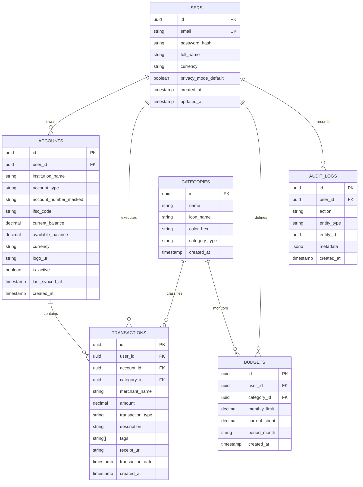

# Database Schema & Entity-Relationship (ER) Diagram

This document describes the relational database schema implemented in **Hold** for PostgreSQL.

### Table Specifications

#### 1. `users`
Stores authenticated user profiles, preferences, and default display currency.

#### 2. `accounts`
Represents individual bank accounts (e.g. HDFC, SBI), credit cards, investment portfolios, or cash reserves. `account_number_masked` ensures sensitive banking digits are never stored in raw plaintext.

#### 3. `categories`
Standardized transaction classifications (e.g. Food & Drinks, Travel, Bills & Utilities, Shopping, Investment, Salary).

#### 4. `transactions`
Double-entry or ledger-level transactions tagged by account, category, merchant, and user-defined tags. Compound index on `(user_id, transaction_date DESC)` ensures instantaneous feed scrolling.

#### 5. `budgets`
Tracks monthly category ceilings and current burn rate for proactive alerting.

#### 6. `audit_logs`
Logs critical modifications, export requests, and authentication events for transparency and audit compliance.
