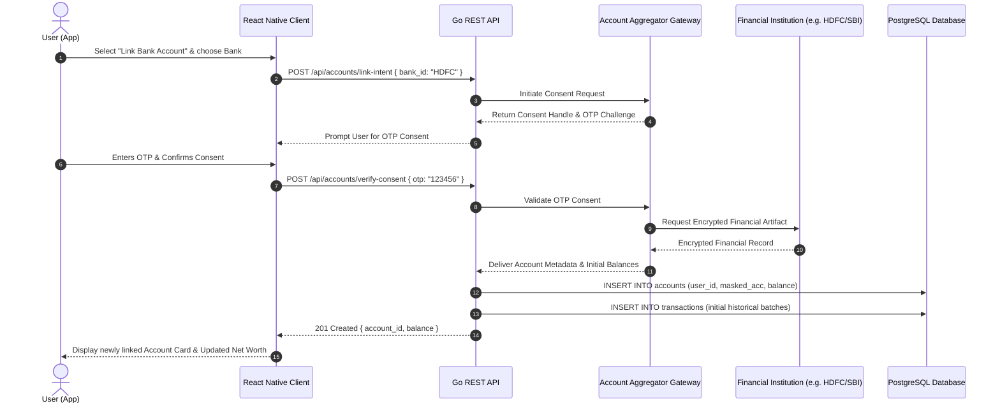
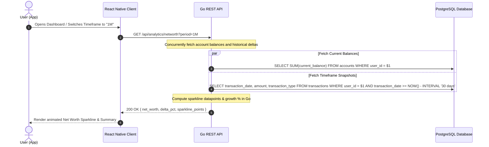
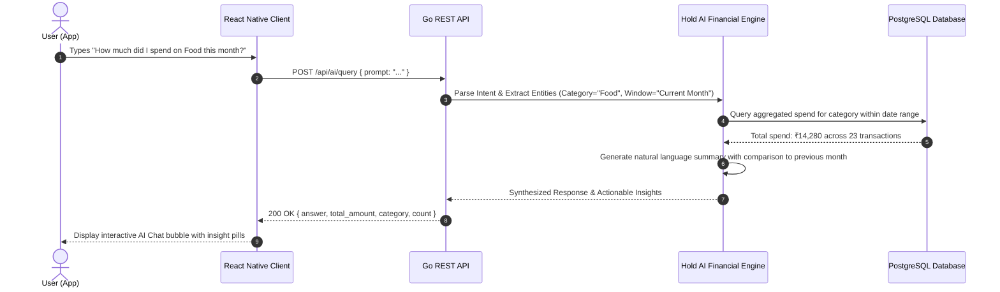

# Sequence Diagrams

This document illustrates the sequential interaction flows for core workflows in **Hold**.

---

## 1. Bank Account Linking & Balance Sync Flow

---

## 2. Real-Time Net Worth & Analytical Query Flow

---

## 3. Hold AI Financial Query Execution Flow

