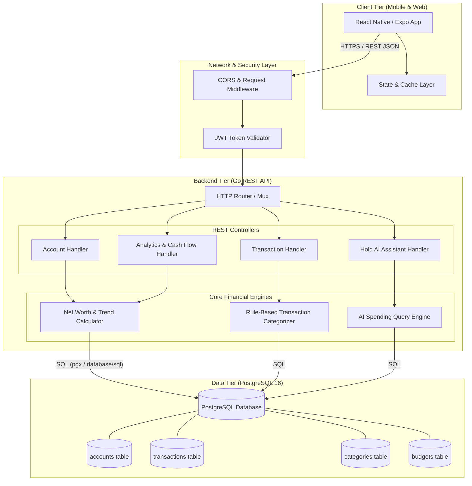

# System Architecture Diagram

This document illustrates the high-level architecture of **Hold**, highlighting the interactions between the cross-platform React Native frontend, the Go REST API backend, and the PostgreSQL database.

### Architectural Highlights
* **Client Tier:** Built with React Native and Expo for unified iOS, Android, and Web rendering. Implements optimistic updates, client-side balance privacy masking, and offline caching.
* **Backend Tier:** High-concurrency Go REST API leveraging goroutines for computing multi-account balance rollups and analytical series in parallel.
* **Data Tier:** Relational PostgreSQL schema with foreign keys, cascading constraints, and compound B-tree indexes on `(user_id, transaction_date)`.
