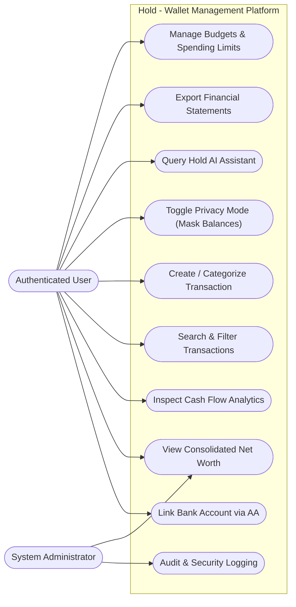

# Use Case Diagram

This document specifies the primary use cases and actor interactions for **Hold**.

### Key Use Cases
* **UC1 - Link Bank Account via AA:** Connect institution using consent OTP without handing over bank login passwords.
* **UC2 - View Consolidated Net Worth:** Real-time ledger calculation across all cash, bank, credit, and investment accounts.
* **UC6 - Toggle Privacy Mode:** Instant client-side masking of all financial numbers for privacy in public areas.
* **UC7 - Query Hold AI Assistant:** Converse with the assistant to discover spending patterns, savings opportunities, and anomaly warnings.
* **UC8 - Export Financial Statements:** Generate clean, exportable statements with optional password protection.
